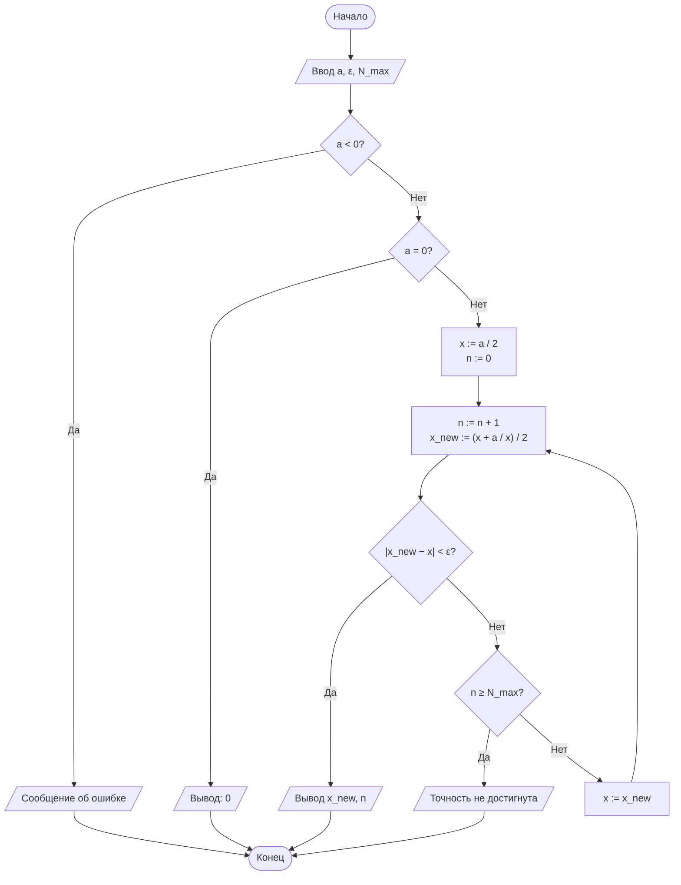
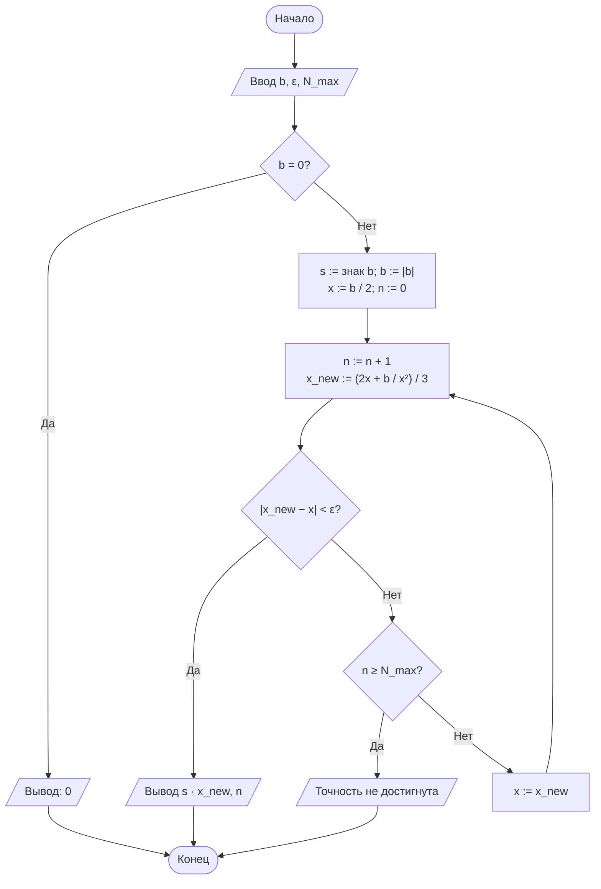
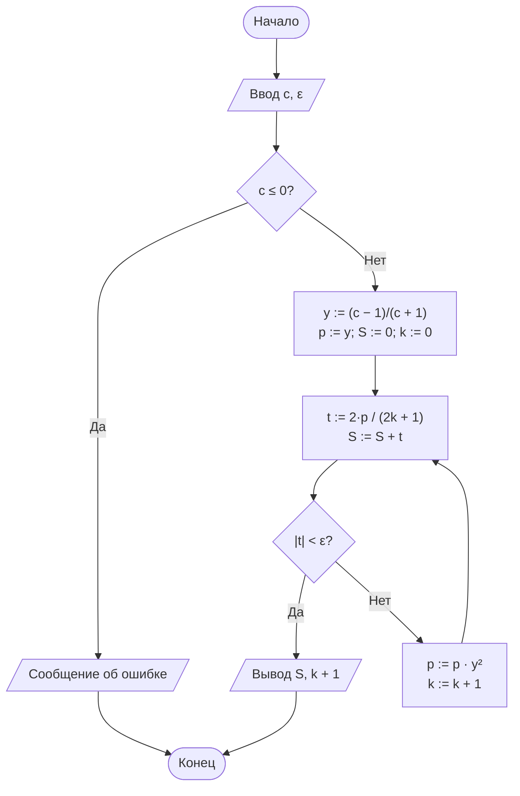

# Лабораторная работа № 1

## Итерационные методы вычисления элементарных функций: квадратный корень, кубический корень и натуральный логарифм

**Дисциплина:** Теория алгоритмов
**Направление подготовки:** 38.03.05 «Бизнес-информатика»
**Курс:** 2
**Вариант:** 13

**Выполнил:** ______________________ (ФИО), группа ______
**Проверил:** ______________________ (ФИО преподавателя)

---

## 1. Цель работы

Сформировать представление об итерационных алгоритмах как о вычислительных процедурах, результат которых достигается последовательным уточнением приближений, и освоить приёмы оценки их сходимости и трудоёмкости.

**Задачи:**

1. Изучить понятия итерационного процесса, начального приближения, критерия остановки и скорости сходимости.
2. Реализовать вычисление $\sqrt{a}$ и $\sqrt[3]{b}$ методом Ньютона и $\ln c$ разложением в степенной ряд.
3. Экспериментально определить число итераций для заданной точности $\varepsilon$.
4. Сравнить результаты с эталонными значениями модуля `math` и оценить абсолютную погрешность.

## 2. Задание варианта 13

Вычислить $\sqrt{31}$, $\sqrt[3]{100}$ и $\ln 0{,}2$ с точностью $\varepsilon = 10^{-5}$.

- критерий остановки для корней — по разности соседних приближений: $\lvert x_{n+1} - x_n \rvert < \varepsilon$;
- для логарифма — по модулю члена ряда: $\lvert t_k \rvert < \varepsilon$;
- начальное приближение: $x_0 = a/2$ (для кубического корня $x_0 = b/2$);
- дополнительное требование **Д1**: вывести таблицу итераций для каждой функции (номер шага, $x_n$, $\lvert x_{n+1} - x_n \rvert$) и проанализировать изменение числа верных знаков.

## 3. Краткие теоретические сведения

**Итерационный алгоритм** строит последовательность приближений $x_{n+1} = \varphi(x_n)$ и определяется начальным приближением $x_0$, итерационной формулой $\varphi$ и критерием остановки. Результативность обеспечивается критерием остановки и ограничением $N_{\max}$.

**Порядок сходимости.** Если $e_{n+1} \approx C e_n^p$, то при $p = 1$ сходимость линейная (число верных знаков растёт на константу за шаг), при $p = 2$ — квадратичная (число верных знаков примерно удваивается).

**Метод Ньютона:** $x_{n+1} = x_n - \dfrac{F(x_n)}{F'(x_n)}$.

- Квадратный корень, $F(x) = x^2 - a$ (формула Герона):
  $$x_{n+1} = \frac{1}{2}\left(x_n + \frac{a}{x_n}\right).$$
- Кубический корень, $F(x) = x^3 - b$:
  $$x_{n+1} = \frac{1}{3}\left(2x_n + \frac{b}{x_n^2}\right).$$
  Для $b < 0$ используется $\sqrt[3]{b} = -\sqrt[3]{\lvert b \rvert}$.

**Натуральный логарифм** вычисляется рядом, сходящимся при любом $c > 0$:

$$\ln c = 2\left(y + \frac{y^3}{3} + \frac{y^5}{5} + \ldots\right), \qquad y = \frac{c-1}{c+1}.$$

Каждый следующий член получается умножением степени на $y^2$: $t_k = \dfrac{2y^{2k+1}}{2k+1}$. Для $c = 0{,}2$ имеем $y = -2/3$.

## 4. Блок-схемы алгоритмов

### 4.1. Квадратный корень



### 4.2. Кубический корень



### 4.3. Натуральный логарифм



## 5. Листинг программы

```python
"""
Лабораторная работа № 1. Вариант 13.
Итерационные методы вычисления sqrt(a), cbrt(b), ln(c).
a=31, b=100, c=0.2, eps=1e-5, критерий остановки: по разности (Р), x0 = a/2, доп. требование Д1.
"""
import math

A, B, C = 31, 100, 0.2
EPS = 1e-5
N_MAX = 100


def sqrt_newton(a, eps=EPS, n_max=N_MAX, trace=None):
    """sqrt(a) методом Ньютона (Герон). Остановка по разности |x_new - x| < eps."""
    if a < 0:
        raise ValueError("Подкоренное выражение должно быть неотрицательным")
    if a == 0:
        return 0.0, 0
    x = a / 2                              # x0 = a/2
    for n in range(1, n_max + 1):
        x_new = 0.5 * (x + a / x)
        if trace is not None:
            trace.append((n, x_new, abs(x_new - x)))
        if abs(x_new - x) < eps:
            return x_new, n
        x = x_new
    raise RuntimeError("Точность не достигнута за N_MAX итераций")


def cbrt_newton(b, eps=EPS, n_max=N_MAX, trace=None):
    """cbrt(b) методом Ньютона. Остановка по разности |x_new - x| < eps."""
    if b == 0:
        return 0.0, 0
    sign = -1 if b < 0 else 1
    b = abs(b)
    x = b / 2                              # x0 = b/2 (аналог x0 = a/2)
    for n in range(1, n_max + 1):
        x_new = (2 * x + b / (x * x)) / 3
        if trace is not None:
            trace.append((n, x_new, abs(x_new - x)))
        if abs(x_new - x) < eps:
            return sign * x_new, n
        x = x_new
    raise RuntimeError("Точность не достигнута за N_MAX итераций")


def ln_series(c, eps=EPS, n_max=10_000, trace=None):
    """ln(c) = 2*(y + y^3/3 + y^5/5 + ...), y=(c-1)/(c+1). Остановка по |член| < eps."""
    if c <= 0:
        raise ValueError("Аргумент логарифма должен быть положительным")
    y = (c - 1) / (c + 1)
    y2 = y * y
    power, total = y, 0.0
    for k in range(n_max):
        term = 2 * power / (2 * k + 1)
        if trace is not None:
            trace.append((k + 1, total + term, abs(term)))
        total += term                      # последний (малый) член тоже добавляем
        if abs(term) < eps:
            return total, k + 1
        power *= y2
    raise RuntimeError("Точность не достигнута за n_max итераций")


def correct_digits(x, ref):
    """Число верных десятичных знаков после запятой."""
    err = abs(x - ref)
    return 16 if err == 0 else max(0, int(-math.log10(err)))


def print_trace(title, trace, ref):
    print(f"\n{title}")
    print(f"{'n':>3}{'x_n':>18}{'|x_n - x_(n-1)|':>20}{'верных знаков':>16}")
    for n, x, d in trace:
        print(f"{n:>3}{x:>18.10f}{d:>20.3e}{correct_digits(x, ref):>16}")


if __name__ == "__main__":
    tables = {}
    rows = []
    for name, f, arg, ref in [("sqrt", sqrt_newton, A, math.sqrt(A)),
                              ("cbrt", cbrt_newton, B, B ** (1 / 3)),
                              ("ln", ln_series, C, math.log(C))]:
        tr = []
        val, n = f(arg, trace=tr)
        rows.append((name, arg, val, ref, abs(val - ref), n))
        tables[name] = (tr, ref)

    print(f"{'Функция':<8}{'Аргумент':>9}{'Результат':>16}{'Эталон':>16}"
          f"{'Погрешность':>14}{'Итераций':>10}")
    for name, arg, val, ref, err, n in rows:
        print(f"{name:<8}{arg:>9}{val:>16.10f}{ref:>16.10f}{err:>14.2e}{n:>10}")

    print_trace("Д1: sqrt(31)", *tables["sqrt"])
    print_trace("Д1: cbrt(100)", *tables["cbrt"])
    print_trace("Д1: ln(0.2) (x_n = частичная сумма, шаг = |член ряда|)", *tables["ln"])
```

## 6. Результаты расчётов

**Таблица 1. Результаты (вариант 13, $\varepsilon = 10^{-5}$)**

| Функция | Аргумент | Результат | Эталон (`math`) | Абс. погрешность | Число итераций |
|---|---|---|---|---|---|
| $\sqrt{a}$ | 31 | 5,5677643628 | 5,5677643628 | 8,88e-16 | 6 |
| $\sqrt[3]{b}$ | 100 | 4,6415888336 | 4,6415888336 | 1,28e-13 | 10 |
| $\ln c$ | 0,2 | -1,6094325152 | -1,6094379124 | 5,40e-06 | 12 |

### 6.1. Д1. Таблица итераций для $\sqrt{31}$

| n | $x_n$ | $\lvert x_n - x_{n-1}\rvert$ | Верных знаков |
|---|---|---|---|
| 1 | 8.7500000000 | 6.750e+00 | 0 |
| 2 | 6.1464285714 | 2.604e+00 | 0 |
| 3 | 5.5950039429 | 5.514e-01 | 1 |
| 4 | 5.5678306715 | 2.717e-02 | 4 |
| 5 | 5.5677643632 | 6.631e-05 | 9 |
| 6 | 5.5677643628 | 3.948e-10 | 15 |

### 6.2. Д1. Таблица итераций для $\sqrt[3]{100}$

| n | $x_n$ | $\lvert x_n - x_{n-1}\rvert$ | Верных знаков |
|---|---|---|---|
| 1 | 33.3466666667 | 1.665e+01 | 0 |
| 2 | 22.2610871255 | 1.109e+01 | 0 |
| 3 | 14.9079892640 | 7.353e+00 | 0 |
| 4 | 10.0886420142 | 4.819e+00 | 0 |
| 5 | 7.0532628641 | 3.035e+00 | 0 |
| 6 | 5.3722119659 | 1.681e+00 | 0 |
| 7 | 4.7364493295 | 6.358e-01 | 1 |
| 8 | 4.6434759942 | 9.297e-02 | 2 |
| 9 | 4.6415896005 | 1.886e-03 | 6 |
| 10 | 4.6415888336 | 7.669e-07 | 12 |

### 6.3. Д1. Таблица итераций для $\ln 0{,}2$

В столбце $x_n$ — частичная сумма ряда, в третьем столбце — модуль добавленного члена.

| n | $x_n$ | $\lvert x_n - x_{n-1}\rvert$ | Верных знаков |
|---|---|---|---|
| 1 | -1.3333333333 | 1.333e+00 | 0 |
| 2 | -1.5308641975 | 1.975e-01 | 1 |
| 3 | -1.5835390947 | 5.267e-02 | 1 |
| 4 | -1.6002612842 | 1.672e-02 | 2 |
| 5 | -1.6060417942 | 5.781e-03 | 2 |
| 6 | -1.6081437978 | 2.102e-03 | 2 |
| 7 | -1.6089342949 | 7.905e-04 | 3 |
| 8 | -1.6092387827 | 3.045e-04 | 3 |
| 9 | -1.6093581896 | 1.194e-04 | 4 |
| 10 | -1.6094056731 | 4.748e-05 | 4 |
| 11 | -1.6094247670 | 1.909e-05 | 4 |
| 12 | -1.6094325152 | 7.748e-06 | 5 |

## 7. Анализ результатов

1. **$\sqrt{31}$.** Число верных знаков по шагам: 0, 0, 1, 4, 9, 15. Начиная с 3-го шага оно примерно удваивается за итерацию — это квадратичная сходимость метода Ньютона. Достаточно 6 итераций.
2. **$\sqrt[3]{100}$.** На шагах 1–6 верных знаков нет, затем их число растёт: 1, 2, 6, 12. Начальное приближение $x_0 = 50$ далеко от корня ($\approx 4{,}64$), и пока $x_n$ велико, величина уменьшается лишь примерно в 1,5 раза за шаг (сходимость близка к линейной). Квадратичный режим наступает вблизи корня. Поэтому потребовалось 10 итераций против 6 для квадратного корня.
3. **$\ln 0{,}2$.** Число верных знаков растёт медленно: 5 знаков после 12 членов. При $\lvert y \rvert = 2/3$ члены ряда убывают примерно в $y^2 \approx 0{,}44$ раза за шаг — это линейная сходимость.
4. Фактическая погрешность методов Ньютона ($\sim 10^{-16}$ и $\sim 10^{-13}$) на много порядков меньше $\varepsilon$: к моменту выполнения критерия по разности квадратичный процесс уже сошёлся с запасом. Для ряда погрешность ($5{,}4 \cdot 10^{-6}$) одного порядка с $\varepsilon$.
5. Критерий «по разности» корректен для методов Ньютона из-за быстрой сходимости, но для линейно сходящегося ряда он занижает реальную погрешность: остаток ряда может превышать последний член. Поэтому в программе последний член добавляется в сумму.

## 8. Выводы

1. Реализованы итерационные алгоритмы вычисления $\sqrt{a}$, $\sqrt[3]{b}$ (метод Ньютона) и $\ln c$ (степенной ряд); без использования `math.sqrt`, `math.log` и `**0.5` внутри вычислительных функций. Все три алгоритма достигли точности $\varepsilon = 10^{-5}$ за 6, 10 и 12 итераций соответственно.
2. Метод Ньютона сходится квадратично, ряд для логарифма — линейно; это подтверждается таблицами Д1.
3. Число итераций методов Ньютона существенно зависит от начального приближения: далёкое $x_0$ увеличивает число шагов на этапе, пока метод ещё не вышел в квадратичный режим.

## 9. Ответы на контрольные вопросы

1. **Итерационный алгоритм** получает результат как предел последовательности приближений $x_{n+1} = \varphi(x_n)$. Дискретность и детерминированность выполняются (шаги заданы однозначно), массовость — алгоритм работает для любых допустимых $a$, $b$, $c$. Результативность в общем случае не гарантируется конечностью процесса и обеспечивается критерием остановки и ограничением $N_{\max}$.
2. Для $F(x) = x^2 - a$: $F'(x) = 2x$, поэтому $x_{n+1} = x_n - \dfrac{x_n^2 - a}{2x_n} = \dfrac{1}{2}\left(x_n + \dfrac{a}{x_n}\right)$ — формула Герона.
3. Критерий по разности проверяет, насколько сдвинулось приближение, по невязке — насколько $x_n$ удовлетворяет уравнению $F(x_n) = 0$. Результаты могут различаться, если $F$ очень пологая (малая невязка при большой ошибке по $x$) или очень крутая (малый шаг при большой невязке).
4. **Порядок сходимости** $p$ определяется соотношением $e_{n+1} \approx C e_n^p$. Метод Ньютона ($p = 2$) удваивает число верных знаков за шаг, а половинное деление ($p = 1$) уменьшает интервал только вдвое.
5. Чем дальше $x_0$ от корня, тем больше итераций. Пример из расчётов: для $\sqrt[3]{100}$ при $x_0 = 50$ потребовалось 10 итераций, из которых первые 6 не дали ни одного верного знака; для $\sqrt{31}$ при $x_0 = 15{,}5$ — 6 итераций.
6. Ряд для $\ln(1+x)$ сходится только при $-1 < x \le 1$, поэтому для $\ln 100$ ($x = 99$) расходится. Ряд с $y = \dfrac{c-1}{c+1}$ даёт $\lvert y \rvert < 1$ при любом $c > 0$ и потому сходится.
7. Нормализация $c = m \cdot 2^k$, $m \in [0{,}5; 1)$, сводит аргумент к области, где $\lvert y \rvert \le 1/3$, и ряд сходится быстрее; $\ln c = \ln m + k \ln 2$.
8. Погрешность может быть намного меньше $\varepsilon$ из-за быстрой сходимости (для метода Ньютона). Но в линейно сходящихся процессах она может и превысить $\varepsilon$: критерий по разности не гарантирует малость погрешности, так как остаток ряда может быть больше последнего члена.
9. $N_{\max}$ защищает от зацикливания, если процесс не сходится или точность недостижима (например, из-за ошибок округления).
10. Пример: расчёт внутренней нормы доходности (IRR) проекта — корень уравнения $NPV(r) = 0$ находится методом Ньютона или секущих.

## 10. Список литературы

1. Кнут Д. Э. Искусство программирования. Т. 1. Основные алгоритмы. — 3-е изд. — М.: Вильямс, 2017.
2. Бахвалов Н. С., Жидков Н. П., Кобельков Г. М. Численные методы. — 9-е изд. — М.: Лаборатория знаний, 2020.
